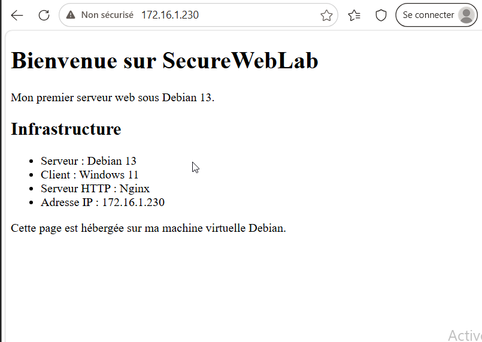

# SecureWebLab

### Laboratoire pédagogique d'administration système, réseau et services web

> **Debian 13 · Windows 11 · VirtualBox · IPv4 · NAT · DHCP · DNS · SSH · SCP · SFTP · WinSCP · Nginx · HTTP · PHP 8.4 / PHP-FPM**

SecureWebLab est un projet pratique réalisé pour comprendre **comment installer, connecter, administrer et sécuriser un serveur Linux**, puis le rendre accessible depuis un client Windows. Chaque configuration est expliquée, accompagnée de tests et, lorsque cela est possible, de captures d'écran réelles.

Ce dépôt a **deux usages** :

1. **Portfolio technique** : montrer les manipulations réellement effectuées, les commandes, les erreurs et leur résolution.
2. **Laboratoire reproductible** : permettre de recréer l'environnement avec des paramètres de démonstration, **sans réutiliser de vrais secrets**.

**Le dépôt décrit un laboratoire privé. Il n'est pas conçu pour être exposé sur Internet tel quel.**

---

## Architecture observée

```text
                     Hôte physique avec VirtualBox
              Réseau NAT « SecureWebLab » 172.16.1.0/24
                                    │
                    Passerelle NAT : 172.16.1.1
                                    │
                ┌───────────────────┴───────────────────┐
                │                                       │
          Windows 11                               Debian 13
          Client VM                               Serveur VM
          172.16.1.5 (DHCP)                       172.16.1.230/24 (statique)
                │                                       │
          Edge, PowerShell                       OpenSSH : TCP/22
          WinSCP, curl                           Nginx : TCP/80
                                                 PHP 8.4, PHP-FPM
```

Les adresses indiquées sont celles observées pendant les tests ; le DHCP peut attribuer une autre adresse au client après un redémarrage.



## Réalisations vérifiées

| Domaine | Résultat observé | Preuve |
|---|---|---|
| Virtualisation | Debian 13 sans interface graphique et Windows 11 sous VirtualBox | [Captures](captures/README.md) |
| Réseau | NAT partagé, IPv4 statique sur Debian, DHCP sur Windows, connectivité ICMP | [Réseau](documentation/02-reseau-dns.md) |
| SSH | Service actif sur TCP/22 ; connexion Windows → Debian réussie | [SSH](documentation/03-ssh-et-cles.md) |
| Durcissement SSH | Connexion par clé ED25519 réussie ; connexion par mot de passe refusée ; accès root SSH désactivé dans la configuration | [Sécurité](documentation/03-ssh-et-cles.md) |
| Fichiers | SCP, SFTP `put`/`get` et WinSCP testés | [Transferts](documentation/04-scp-sftp-winscp.md) |
| Intégrité | Empreintes SHA-256 identiques après aller-retour du fichier | [Transferts](documentation/04-scp-sftp-winscp.md) |
| Web | Nginx actif, page HTML personnelle accessible depuis Edge, HTTP 200 et journaux consultés | [Nginx](documentation/05-nginx-et-http.md) |
| PHP | PHP 8.4 CLI et service PHP-FPM actifs ; socket Unix observé | [PHP-FPM](documentation/06-php-fpm.md) |

**Périmètre des preuves :** la liaison Nginx → PHP-FPM est fournie dans les exemples de laboratoire mais aucun test final de page PHP par navigateur n'a été montré au moment de rédiger ce dépôt. Ce test n'est donc pas présenté comme une réalisation vérifiée.

## Parcourir le projet

| Dossier | Contenu |
|---|---|
| [`documentation/`](documentation/) | Compte rendu, notions, commandes, FAQ et incidents résolus |
| [`laboratoire/`](laboratoire/) | Guide de reproduction étape par étape et tests de validation |
| [`configurations/`](configurations/) | Fichiers de configuration commentés (exemples, non exports secrets) |
| [`scripts/debian/`](scripts/debian/) | Scripts facultatifs d'installation, de vérification et de configuration |
| [`scripts/windows/`](scripts/windows/) | Génération de clé de démonstration et tests client PowerShell |
| [`site-web/`](site-web/) | Page HTML d'exemple et exemple PHP indépendant |
| [`exemples/`](exemples/) | Identifiants de laboratoire fictifs, fichiers modèles et avertissements |
| [`captures/`](captures/) | Captures prises lors des manipulations, avec index |

### Documentation à lire

- [00 — Compétences démontrées](documentation/00-competences-et-resultats.md)
- [01 — Présentation de l'environnement](documentation/01-architecture-et-virtualisation.md)
- [02 — Réseau, IPv4, NAT, DHCP et DNS](documentation/02-reseau-dns.md)
- [03 — SSH, cryptographie et durcissement](documentation/03-ssh-et-cles.md)
- [04 — SCP, SFTP et WinSCP](documentation/04-scp-sftp-winscp.md)
- [05 — Nginx et HTTP](documentation/05-nginx-et-http.md)
- [06 — PHP et PHP-FPM](documentation/06-php-fpm.md)
- [07 — Incidents rencontrés et résolus](documentation/07-incidents-et-solutions.md)
- [08 — Questions posées et notions acquises](documentation/08-questions-reponses.md)
- [09 — Commandes utiles et preuves](documentation/09-commandes-et-preuves.md)
- [Sécurité : secrets et données de démonstration](documentation/10-securite-des-secrets.md)

### Reproduire le laboratoire

Voir [`laboratoire/README.md`](laboratoire/README.md). Le guide utilise des téléchargements officiels de Debian/Windows/VirtualBox et propose de **générer ses propres clés**. Les scripts sont des exemples lisibles, non une image de VM déjà préparée.

**Machine virtuelle Debian préconfigurée :** elle pourra être distribuée séparément ultérieurement ; aucune image `.ova`/`.vdi` n'est incluse dans cette version.

---

## Note de sécurité

Les noms d'utilisateurs, adresses IP privées et mots de passe *fictifs* servent à la démonstration. **Aucune clé privée réelle, aucun mot de passe réel, aucun disque contenant des identifiants personnels n'est fourni.** Pour étudier les clés privées, le guide montre comment créer localement des clés de démonstration distinctes de celles utilisées dans le projet initial.

Un dépôt public n'est pas un coffre-fort : supprimer plus tard un secret d'un fichier ne le retire pas automatiquement de l'historique Git ni des copies existantes. [Lire les précautions](documentation/10-securite-des-secrets.md).

## Contexte

Environnement construit et testé en octobre 2026 dans le cadre d'un apprentissage de l'administration Linux, des réseaux et des services web. Les commandes ont été relevées sur des machines de laboratoire ; certaines options peuvent varier selon les versions des logiciels.
